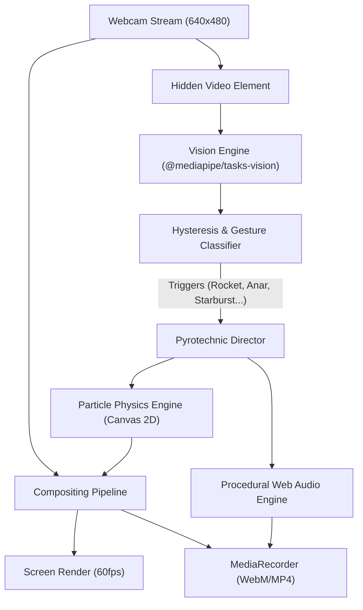

# Fireworks Conductor — System Architecture

## 1. System Overview

Fireworks Conductor is a client-side web application that turns hand gestures into authentic Diwali fireworks overlaid on real-time webcam video. It executes entirely in the browser with zero external backend dependencies.

---

## 2. Component Specifications

### 2.1 Video & Compositing Pipeline
- **Input Stream:** Constrained to `640x480` to minimize bus bandwidth and GPU memory transfer latency.
- **Atmospheric Night Sky Shading:** The webcam feed is processed through a subtle nighttime filter (brightness 0.45, contrast 1.15, slight blue-indigo ambient grading).
- **Additive Canvas Overlay:** Full viewport resolution HTML5 Canvas running `globalCompositeOperation = 'lighter'`. All firework particles are rendered additively, creating white-hot core luminosity where sparks cluster.

### 2.2 Vision Engine (`src/vision/`)
- **Model:** MediaPipe Tasks Vision `HandLandmarker` with `float16` precision:
  `https://storage.googleapis.com/mediapipe-models/hand_landmarker/hand_landmarker/float16/1/hand_landmarker.task`
- **Execution Mode:** `runningMode: "VIDEO"` with `delegate: "GPU"`.
- **Temporal Filter:** OneEuroFilter / Landmark smoothing to eliminate camera sensor jitter.
- **Gesture Stabilizer:** 100ms hold requirement and 50ms grace window to prevent false triggers during transitions.
- **7 Gesture Mappings:**
  1. `ROCKET`: Only index finger extended upward. Rest curled into palm.
  2. `ANAR` (Fountain): Closed fist (no fingers extended).
  3. `STARBURST`: All five fingers spread wide.
  4. `ROMAN_CANDLE`: Peace sign (index + middle extended, ring + pinky curled).
  5. `PHOOLJHADI` (Sparkler): Pinch (distance between thumb tip and index tip < 38px).
  6. `GRAND_FINALE`: Both hands detected with open palms.

### 2.3 Particle Physics Engine (`src/particles/`)
- **Particle State:** `[x, y, vx, vy, prevX, prevY, colorR, colorG, colorB, alpha, life, maxLife, size, decay, drag, gravity]`.
- **Pre-rendered Sprites:** Offscreen canvas radial glow cache for instant blitting with high visual fidelity.
- **Sub-frame Motion Trails:** Lines connecting $(x_{t-1}, y_{t-1})$ to $(x_t, y_t)$ with velocity-dependent stroke width and head glow.
- **Color Temperature Ramps:** Particles shift from white-hot core (`#FFFFFF`) to chemical vibrant color (`#FF2244`, `#00FF66`, `#FFD700`, `#39FF14`, `#FF1493`) and cool down to dark ember orange/smoke (`#441100`).

### 2.4 Procedural Web Audio Engine (`src/audio/`)
- Completely standalone without any external audio asset loading.
- **Rocket:** Frequency-swept oscillator ($300\text{Hz} \to 1800\text{Hz}$) with envelope + burst low-pass noise.
- **Explosion/Boom:** Multi-layered sub-bass sine drop ($90\text{Hz} \to 25\text{Hz}$) + resonant filtered pink noise.
- **Fountain / Anar:** Continuous sizzle combining high-pass filtered white noise with randomized crackle impulses.
- **Sparkler:** Micro-impulse crackler with variable density and pitch jitter.

### 2.5 Capture Engine (`src/capture/`)
- **MediaStreamDestination:** Web Audio destination node mixed directly into the recording track.
- **Canvas Capture:** `canvas.captureStream(30)`.
- **Format:** `video/webm;codecs=vp9,opus` with fallback to `video/webm`.
- **Screenshot:** Native canvas `toBlob('image/png')` with optional festive gold watermark ("✨ Happy Diwali ✨").
- **Creator Mode (`H` hotkey):** Hides all UI overlays, allowing clean performance recordings for video reels.
